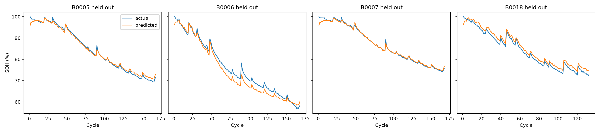

# AI Battery Health Estimator

Estimating lithium-ion battery **State of Health (SOH)** from discharge data (voltage, current, temperature, and time) using the NASA battery dataset and machine learning regression models.

**SOH Formula:**

SOH = (Present Capacity / First-Cycle Capacity) × 100

This project is an educational study of battery data and regression models, not a complete battery-management system.

## Results

A one-feature linear regression model achieves an average **RMSE of 1.28 SOH percentage points** and **R² of 0.981** on batteries excluded from training.

**Final Model Equation**

```text
SOH = 48.82 × t_norm + 47.24
```

Here, `t_norm` is the time taken for a cell's voltage to fall to 3.5 V during discharge, normalized by the corresponding time from its first cycle.

| Model | Features | RMSE | R² |
|---|---|---:|---:|
| Baseline (Linear) | Cycle number | 5.90 | 0.603 |
| Ridge Regression | All 8 | 3.97 | 0.817 |
| Random Forest | All 8 | 3.39 | 0.868 |
| XGBoost | All 8 | 3.35 | 0.864 |
| Ridge Regression | 3 | 2.76 | 0.912 |
| Linear Regression | Time to 3.5 V | 1.83 | 0.958 |
| **Linear Regression (Final)** | **Normalized time** | **1.28** | **0.981** |

RMSE is measured in SOH percentage points. Results are averaged using leave-one-battery-out validation.

**Main Finding:** A single physically meaningful feature generalized better across batteries than models using more features and greater complexity.

### Final Model Visualization



## Dataset

This project uses the NASA Prognostics Center of Excellence Lithium-Ion Battery Dataset.

**Battery cells:** B0005, B0006, B0007, and B0018  
**Total discharge cycles:** 636

The original dataset files are excluded from this repository.

### Download Instructions

1. Download the dataset: [NASA Battery Data Set](https://phm-datasets.s3.amazonaws.com/NASA/5.+Battery+Data+Set.zip).
2. Extract the downloaded ZIP file.
3. Locate the `1. BatteryAgingARC-FY08Q4` folder.
4. Copy `B0005.mat`, `B0006.mat`, `B0007.mat`, and `B0018.mat` into the project's `data/` folder.

**Dataset Citation**

B. Saha and K. Goebel (2007). *Battery Data Set*. NASA Prognostics Data Repository, NASA Ames Research Center, Moffett Field, California.

## Methodology

### 1. Data Processing

- Load battery discharge data from MATLAB `.mat` files.
- Extract voltage, current, temperature, time, and capacity measurements.
- Calculate SOH from the measured capacity of each discharge cycle.

### 2. Feature Engineering

Eight features are extracted for each cycle:

- Discharge duration
- Time to reach 3.5 V
- Mean voltage
- Minimum voltage
- Maximum temperature
- Mean temperature
- Mean current
- Energy delivered

Measured capacity is used as the target label, not as a model input feature.

### 3. Model Training

The following approaches are evaluated:

- Linear regression baseline using cycle number
- Ridge regression
- Random Forest regression
- XGBoost regression
- Reduced feature-set models
- Normalized one-feature linear regression

### 4. Validation

Leave-one-battery-out validation is used. Three battery cells are used for training and the fourth is reserved for testing, rotating the test cell across the four batteries.

This approach helps evaluate generalization to an unseen battery rather than relying on random splits of neighboring cycles.

### 5. Evaluation Metrics

- **RMSE:** Root Mean Squared Error
- **MAE:** Mean Absolute Error
- **R²:** Coefficient of Determination

## Project Structure

```text
battery-soh/
├── data/
│   └── Battery MATLAB files (download separately)
├── notebooks/
│   └── soh.ipynb
├── .gitignore
├── README.md
├── requirements.txt
├── final_model.png
├── results_final_model.csv
└── results_linear_1feature.csv
```

## Installation and Usage

### Prerequisites

- Python 3.10 or later, compatible with the installed dependencies
- Jupyter Notebook or the VS Code Jupyter extension
- NASA battery dataset files

### Step 1: Clone the Repository

```bash
git clone https://github.com/prathameshdoiphode377-spec/battery-soh-estimator.git
cd battery-soh-estimator
```

### Step 2: Create a Virtual Environment

```bash
python -m venv venv
```

Activate it on Windows PowerShell:

```powershell
.\venv\Scripts\Activate.ps1
```

### Step 3: Install Dependencies

```bash
pip install -r requirements.txt
```

### Step 4: Prepare the Dataset

Download and extract the NASA battery dataset, then place the four `.mat` files inside the `data/` directory.

### Step 5: Run the Notebook

Open `notebooks/soh.ipynb` in VS Code or Jupyter Notebook, select the virtual environment as the Python kernel, and execute the cells in order.

## Limitations

- Only four battery cells from a single laboratory dataset are evaluated.
- The model requires discharge measurements and a first-cycle reference for each cell.
- The feature was selected after examining correlations across all four cells, which may make the reported performance optimistic.
- A new cell is predicted at approximately 96% SOH rather than 100%, because the regression line is not constrained to pass through 100%.
- Hyperparameters were not tuned.
- Performance has not been validated on the Oxford Battery Degradation Dataset.

## Future Work

- Validate the model on the Oxford Battery Degradation Dataset.
- Investigate partial-discharge and charging-phase features.
- Explore incremental capacity analysis using dQ/dV.
- Perform feature selection within each validation fold.
- Develop remaining useful life (RUL) prediction models.

## Author

**Prathamesh Doiphode**  
Bharati Vidyapeeth College of Engineering, Pune
